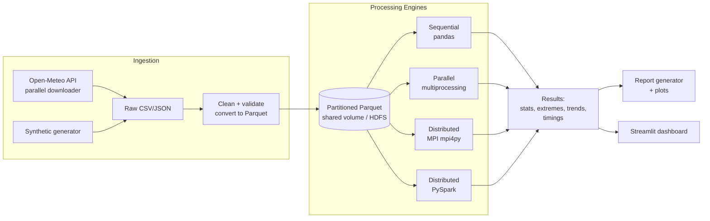
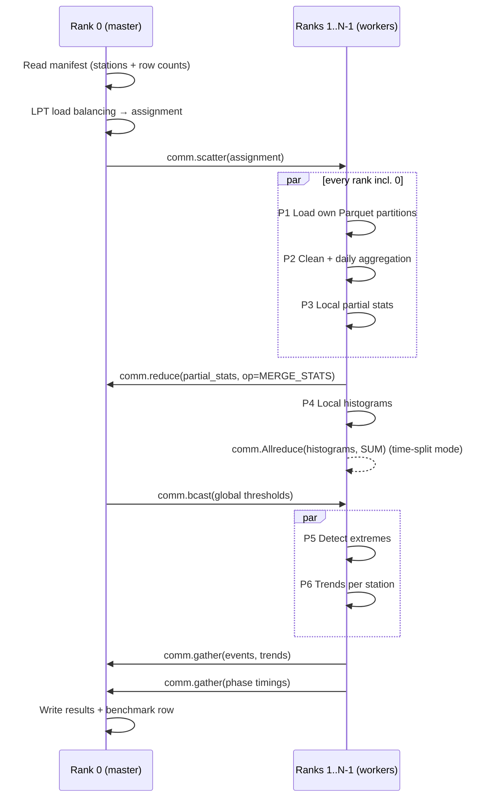

# Implementation Plan
## Distributed Weather Data Processing and Extreme Weather Detection

**Course:** Parallel and Distributed Systems Laboratory
**Goal:** Build a system that ingests large volumes of historical weather observations, computes min/max/average statistics, detects extreme temperature, rainfall, humidity and wind events, finds long-term trends, and measures how processing time improves when the work is split across multiple processes and machines.

---

## 1. Problem Statement

Weather datasets are large (millions to billions of readings across thousands of stations and decades), and most analysis on them can run independently per station or per time block, which makes them a good fit for parallel and distributed processing.

The system must:

1. Load a historical (or simulated) weather dataset with **temperature, rainfall, humidity and wind** fields.
2. Compute **minimum / maximum / average** values per station, month, year and globally.
3. Detect **extreme weather records** using both fixed meteorological thresholds and statistical (percentile / z-score) methods.
4. Identify **trends** (warming, rising rainfall extremes, more frequent heatwaves).
5. Report **processing time** and compare a sequential baseline with parallel and distributed versions (speedup, efficiency, scalability).

---

## 2. Objectives Mapped to PDS Concepts

| Objective | PDS concept demonstrated |
|---|---|
| Sequential baseline in pandas/NumPy | Reference point for speedup (T₁) |
| Multi-core version with `multiprocessing` | Shared-memory parallelism, process pools, data parallelism |
| Multi-node version with **MPI (`mpi4py`)** | Message passing, Scatter/Gather, Reduce/Allreduce, Broadcast, custom reduction ops, load balancing |
| Multi-node version with **Apache Spark (PySpark)** | MapReduce, DAG execution, partitioning, shuffles, lazy evaluation, fault tolerance via lineage |
| Docker Compose cluster (1 master + N workers) | Cluster setup, node communication, resource isolation |
| Benchmark suite | Strong and weak scaling, Amdahl's law, Gustafson's law, Karp–Flatt metric |
| Time-chunk partitioning with halo rows | Domain decomposition and boundary exchange |
| Global percentile via merged histograms | Distributed aggregation with mergeable summaries |

---

## 3. Dataset Strategy

We use **two data sources**: real data for realistic results and simulated data so we can scale the volume up as far as the benchmarks need.

### 3.1 Primary: real historical data (recommended)

**Open-Meteo Historical Weather API (ERA5 reanalysis)**: free, no API key, hourly data from 1940 onward for any latitude/longitude.

- Endpoint: `https://archive-api.open-meteo.com/v1/archive`
- Hourly variables: `temperature_2m`, `relative_humidity_2m`, `precipitation`, `wind_speed_10m`, `wind_gusts_10m`
- Plan: **50 Indian and world cities × 30 years (1995–2024) × hourly**, about **13 million rows**
- All four required parameters (temperature, rain, humidity, wind) come from a single consistent source.

**Alternatives (to mention in the report):**

| Dataset | Pros | Cons |
|---|---|---|
| NOAA GHCN-Daily | 100k+ stations, very large, standard in climate research | Humidity not included; sentinel values (-9999) need cleaning |
| NOAA ISD / Global Hourly | Hourly, includes dew point (RH can be derived), wind | Fixed-width format, heavier parsing |
| IMD gridded data (India) | Official Indian rainfall/temperature | Binary grid format, limited variables |
| Kaggle "Weather History" (Szeged) | Small and easy | Too small to show distributed speedup |

### 3.2 Secondary: simulated data generator (for scaling)

A **synthetic generator** (`data/generator.py`) produces realistic data at any size (1M → 100M+ rows):

- **Temperature:** `T(t) = base_lat + A_season·sin(2π·doy/365) + A_daily·sin(2π·hour/24) + trend·years + AR(1) noise`
- **Humidity:** inversely correlated with temperature, clipped to [5, 100] %
- **Rainfall:** two-stage model, Bernoulli (rain/no-rain, monsoon-weighted) × Gamma distribution for amount
- **Wind:** Weibull distribution (k≈2, standard for wind speed); gusts = speed × (1.3–1.8)
- **Injected extremes:** heatwaves (3–7 day blocks +6–10 °C), cloudbursts, cyclone-like wind spikes, all with **known ground truth**, so we can measure detection precision and recall
- The generator itself runs in parallel (each worker generates its own stations with a deterministic seed = `hash(station_id)`)

### 3.3 Unified schema (Parquet)

| Column | Type | Unit |
|---|---|---|
| `station_id` | string | n/a |
| `station_name` | string | n/a |
| `lat`, `lon`, `elevation` | float | degrees, m |
| `timestamp` | timestamp (UTC) | n/a |
| `temp_c` | float32 | °C |
| `humidity_pct` | float32 | % |
| `precip_mm` | float32 | mm (per hour) |
| `wind_kmh` | float32 | km/h |
| `gust_kmh` | float32 | km/h |

Storage: **Parquet, partitioned by `station_id`** (columnar, compressed, splittable, and each worker reads only its own stations).

---

## 4. System Architecture



### 4.1 Cluster setup (Docker Compose)

```
┌─────────────────────────── Docker network: pdsnet ───────────────────────────┐
│  master (rank 0 / Spark master + driver)                                      │
│  worker1 (rank 1 / Spark worker)                                              │
│  worker2 (rank 2 / Spark worker)                                              │
│  worker3 (rank 3 / Spark worker)                                              │
│  Shared volume: /data (Parquet)   /results (outputs)                          │
└───────────────────────────────────────────────────────────────────────────────┘
```

- One image: Python 3.11 + OpenMPI + mpi4py + PySpark + Java 17 + pandas/pyarrow
- MPI: passwordless SSH between containers, `hostfile` lists the nodes
- Spark: standalone cluster mode (`spark://master:7077`), Web UI on port 8080
- **Real multi-machine option:** run the same image on 3–4 lab PCs on the same LAN (MPI hostfile with their IPs, Spark workers pointing to the master IP). This is the strongest demo for the lab.

---

## 5. Processing Pipeline (common to all engines)

Every engine implements the **same 6 phases** with the same logic, so the results can be compared one to one and the timings are fair.

| Phase | Work | Parallel pattern |
|---|---|---|
| **P1 Load** | Read Parquet partitions | Each worker reads its own stations |
| **P2 Clean** | Drop/flag nulls, physical range checks, dedupe timestamps, hourly → daily aggregation | Embarrassingly parallel (map) |
| **P3 Statistics** | min/max/mean/std per station, month, year; global | Map + **Reduce** (mergeable aggregates) |
| **P4 Thresholds** | Station-month climatology percentiles (P5, P95, P99) | Local histograms → **Allreduce** → **Broadcast** |
| **P5 Extreme detection** | Threshold + statistical + multi-day events | Map (per station, time-contiguous) |
| **P6 Trends** | Yearly aggregates, OLS slope, Mann–Kendall, Sen's slope | Map per station → **Gather** |

### 5.1 Data cleaning rules

| Field | Valid range | Action if invalid |
|---|---|---|
| `temp_c` | −90 to 60 | set NaN, count as flagged |
| `humidity_pct` | 0 to 100 | clip if within ±2, else NaN |
| `precip_mm` | 0 to 500 (hourly) | negative becomes NaN |
| `wind_kmh` | 0 to 400 | NaN |
| Duplicate `(station, timestamp)` | n/a | keep first |
| Gaps > 6 h | n/a | do not interpolate; mark day as incomplete if < 20 h present |

**Daily aggregation:** `Tmax`, `Tmin`, `Tmean`, `RH_mean`, `RH_max`, `RH_min`, `precip_sum`, `wind_max`, `gust_max`. Daily values are the basis for most meteorological definitions.

### 5.2 Statistics (Expected Output: min / max / average)

Each worker produces **partial aggregates** that can be merged exactly:

```
partial = (count, sum, sum_sq, min, max, argmin_time, argmax_time)
merge(a, b) = (a.count+b.count, a.sum+b.sum, a.sum_sq+b.sum_sq,
               min(a.min,b.min), max(a.max,b.max), ...)
mean = sum/count ;  std = sqrt(sum_sq/count − mean²)
```

For numerical stability we use **Welford / Chan's parallel variance algorithm** instead of naive `sum_sq`. This is a good discussion point in the report.

Output levels:
- Per station, overall
- Per station × year
- Per station × month (climatology)
- Global (all stations): records such as "hottest temperature ever recorded in the dataset, where and when"

### 5.3 Extreme weather detection

Three complementary methods:

#### (a) Fixed meteorological thresholds (IMD / WMO / NWS based)

| Category | Rule (daily) | Severity levels |
|---|---|---|
| **Heatwave** (IMD) | Tmax ≥ 40 °C **and** departure from normal ≥ 4.5 °C; or Tmax ≥ 45 °C | Heatwave / Severe (departure ≥ 6.5 °C or Tmax ≥ 47 °C) |
| **Cold wave** (IMD) | Tmin ≤ 10 °C **and** departure ≤ −4.5 °C | Cold wave / Severe (≤ −6.5 °C) |
| **Heavy rainfall** (IMD) | precip_sum ≥ 64.5 mm | Heavy 64.5–115.5 · Very heavy 115.6–204.4 · Extremely heavy ≥ 204.5 |
| **Cloudburst** | ≥ 100 mm in 1 hour | Single severity |
| **Dangerous heat stress** | Heat Index (from T + RH, Rothfusz eq.) ≥ 41 °C | Caution 27–32 · Extreme caution 32–41 · Danger 41–54 · Extreme danger ≥ 54 |
| **Extreme humidity** | RH_mean ≥ 95 % (saturated) or RH_min ≤ 10 % (very dry / fire risk) | High / Low |
| **High wind** (Beaufort) | wind_max ≥ 62 km/h | Gale (B8) ≥ 62 · Strong gale (B9) ≥ 75 · Storm (B10) ≥ 89 · Violent storm (B11) ≥ 103 · Hurricane force (B12) ≥ 118 |

#### (b) Statistical anomaly detection (location-relative)

Thresholds such as "40 °C" mean different things in Delhi and in London, so we also flag values that are extreme **for that station and month**:

- **Percentile method (ETCCDI-style):** value > P99 or < P1 of the station-month climatology
- **Z-score:** |x − μ_station,month| / σ_station,month > 3
- **IQR:** x > Q3 + 3·IQR

**Distributed challenge:** exact percentiles need all the data in one place. Solution:
1. Each worker builds **fixed-bin histograms** (e.g. 0.1 °C bins) per (station, month).
2. `MPI.Allreduce(SUM)` merges the histograms. This is only needed when a station is split across workers (time partitioning); with station partitioning the histograms stay local.
3. Percentiles are read from the cumulative histogram, with the error bounded by bin width.
4. Spark version: `percentile_approx` (Greenwald–Khanna). Compare its accuracy with the exact version.

#### (c) Multi-day events (spell detection)

- **Heatwave spell:** ≥ 3 consecutive days satisfying the heatwave rule
- **Warm Spell Duration Index (WSDI):** ≥ 6 consecutive days with Tmax > P90
- **Consecutive Dry Days (CDD)** and **Consecutive Wet Days (CWD)**: longest run with precip < 1 mm / ≥ 1 mm
- **Rx5day:** maximum 5-day rainfall total

Algorithm: run-length encoding (the "gaps and islands" technique): `group = date − row_number()` over flagged days, then group by and keep groups with count ≥ k.

**Distributed challenge:** if data is split by **time**, a heatwave can cross the boundary between two workers. Solution: **halo / ghost rows**, where each worker also receives the last *k−1* days of the previous chunk (MPI `Sendrecv` with its neighbour rank). This is a classic domain-decomposition concept that is worth demonstrating.

Each detected event is stored as:

```
event_id, station_id, event_type, severity, start_time, end_time,
duration_days, peak_value, peak_time, method (threshold|percentile|zscore)
```

### 5.4 Trend analysis

| Trend | Method |
|---|---|
| Annual mean Tmax / Tmin per station | OLS linear regression → slope in °C/decade |
| Significance | **Mann–Kendall test** (non-parametric, p < 0.05) + **Sen's slope** |
| Annual rainfall total & Rx1day | Same as above |
| Count of extreme days per year (heatwave days, heavy-rain days) | Same as above, answering "are extremes becoming more frequent?" |
| Seasonal pattern | Monthly climatology curves |
| Smoothing | 30-day and 365-day rolling means |
| Decadal comparison | 1995–2004 vs 2005–2014 vs 2015–2024 means & extreme counts |

Trends are computed **per station in parallel** (independent tasks), then gathered for a global summary such as "X of 50 stations show significant warming".

---

## 6. Parallel / Distributed Implementations

### 6.1 Sequential baseline (`engines/sequential.py`)
- Plain pandas loop over stations. This is the reference time **T₁** for computing speedup.

### 6.2 Shared-memory parallel (`engines/parallel_mp.py`)
- `multiprocessing.Pool(p)` with `imap_unordered` over station partitions
- Each task = full P2–P6 pipeline for one station, returning partial results
- Main process merges the results (reduce)
- Compare `chunksize` values and static vs dynamic scheduling

### 6.3 MPI distributed (`engines/mpi_engine.py`), the core of the lab



Key MPI features used:
| Feature | Where |
|---|---|
| `scatter` | Distribute station assignments |
| `bcast` | Send config and global thresholds |
| `reduce` with **custom `MPI.Op.Create`** | Merge (count, mean, M2, min, max) partial stats |
| `Allreduce` on NumPy buffers (uppercase API) | Merge histograms quickly, no pickling |
| `gather` | Collect events, trends, timings |
| `Sendrecv` | Halo exchange in time-partitioned mode |
| `MPI.Wtime()` + `Barrier` | Per-phase timing |

**Two partitioning strategies (compared in the report):**
1. **Station-based (default):** each rank owns whole stations, so there is no boundary issue and almost no communication. Load imbalance is possible because stations have different row counts, so we use **LPT greedy bin-packing** (sort stations by size and assign each to the least-loaded rank).
2. **Time-based:** each rank owns a year range for all stations. This needs halo exchange and histogram Allreduce, which means more communication and shows the trade-off.

**Optional third mode: dynamic master–worker:** rank 0 hands out one station at a time on request (`send`/`recv` with tags). This is better for heterogeneous lab machines.

### 6.4 Apache Spark (`engines/spark_engine.py`)

- `spark.read.parquet("/data/weather")`, then `repartition("station_id")`
- Hourly → daily: `groupBy(station_id, to_date(timestamp)).agg(...)`
- Stats: `groupBy(...).agg(min, max, avg, stddev)`
- Climatology percentiles: `percentile_approx(temp_c, [0.01, 0.95, 0.99])` per (station, month), then a **broadcast join** back to the daily data
- Spells: Window functions (`row_number`, `lag`) for gaps-and-islands
- Trends: `groupBy(station_id).applyInPandas(trend_fn, schema)`, which runs the Mann–Kendall test as a Pandas UDF on each group
- `.cache()` daily DataFrame (used by P3–P6)
- Explain the **DAG / stages / shuffles** from the Spark UI in the report
- Demo fault tolerance: kill a worker container mid-job and show that Spark recomputes the lost partitions from lineage

### 6.5 Stretch: Dask
- Same pipeline using `dask.dataframe`, so a third framework can be compared if time permits.

---

## 7. Performance Evaluation (Expected Output: processing time)

### 7.1 Metrics
| Metric | Formula |
|---|---|
| Speedup | S(p) = T₁ / Tₚ |
| Efficiency | E(p) = S(p) / p |
| Karp–Flatt serial fraction | e = (1/S − 1/p) / (1 − 1/p) |
| Throughput | rows processed / second |
| Communication overhead | time in MPI calls / total time |
| Phase breakdown | time per phase P1–P6 (shows which phase dominates) |

### 7.2 Experiments
| Experiment | Configuration |
|---|---|
| **Strong scaling** | Fixed 13M (real) & 100M (synthetic) rows; p = 1, 2, 4, 8, 12, 16 |
| **Weak scaling** | 5M rows per worker; p = 1, 2, 4, 8 |
| **Data size scaling** | 1M, 10M, 50M, 100M rows at fixed p |
| **Framework comparison** | Sequential vs multiprocessing vs MPI vs Spark (same data, same cores) |
| **Partitioning comparison** | Station-based vs time-based vs dynamic (MPI) |
| **Load balancing** | Round-robin vs LPT vs dynamic |
| **File format** | CSV vs Parquet read time |

Each configuration runs **3 times** and we report the median; first-run warm-up (JVM startup for Spark) is reported separately.

### 7.3 Expected observations (hypotheses to verify)
- Near-linear speedup for station partitioning until I/O or core count saturates
- Spark slower than MPI on small data (JVM/scheduling overhead) but closer to it at 100M rows
- Time partitioning has higher communication cost than station partitioning
- Amdahl ceiling from the serial parts: manifest read, final merge, and report writing

---

## 8. Outputs

All written to `results/<engine>_<timestamp>/`:

| File | Content |
|---|---|
| `summary_stats.csv` | Station, level (overall/year/month), min/max/mean/std per variable + when min/max occurred |
| `global_records.json` | Highest/lowest temperature, max daily rainfall, max gust, extreme RH, with station & date |
| `extreme_events.csv` | Every detected event (schema in §5.3) |
| `extreme_summary.csv` | Counts by type × severity × station × year |
| `trends.csv` | Station, variable, slope/decade, Sen's slope, MK p-value, significant? |
| `benchmark.csv` | engine, p, nodes, rows, partition_mode, phase times, total time |
| `plots/` | Temperature trend lines, extreme-event counts per year, heatmap station×year, rainfall histogram, speedup & efficiency curves, phase breakdown stacked bars |
| `report.md` / `report.html` | Auto-generated human-readable report |

**Dashboard (Streamlit):** station selector, time-series with highlighted extremes, map of stations coloured by warming trend, benchmark charts.

---

## 9. Project Structure

```
weather/
├── implementation_plan.md
├── project_workflow.md
├── README.md
├── requirements.txt
├── config.yaml                  # thresholds, paths, station list, years
├── docker/
│   ├── Dockerfile
│   ├── docker-compose.yml       # master + 3 workers
│   ├── hostfile                 # MPI hosts
│   └── ssh/                     # keys for MPI between containers
├── data/
│   ├── stations.csv             # 50 cities: id, name, lat, lon, elevation
│   ├── downloader.py            # Open-Meteo parallel fetch (thread pool, rate-limited)
│   ├── generator.py             # synthetic data with injected extremes
│   └── to_parquet.py            # clean + convert + partition
├── core/                        # shared logic used by ALL engines
│   ├── cleaning.py
│   ├── aggregates.py            # mergeable stats (Welford/Chan)
│   ├── thresholds.py            # IMD/Beaufort/HI rules + percentile helpers
│   ├── detection.py             # threshold, statistical, spell detection
│   ├── trends.py                # OLS, Mann–Kendall, Sen's slope
│   └── timing.py                # phase timer context manager
├── engines/
│   ├── sequential.py
│   ├── parallel_mp.py
│   ├── mpi_engine.py
│   └── spark_engine.py
├── benchmark/
│   ├── run_benchmarks.sh
│   └── analyze.py               # speedup/efficiency tables + plots
├── reporting/
│   ├── make_report.py
│   └── dashboard.py             # Streamlit
├── tests/
│   ├── test_aggregates.py       # merge(a,b) == stats(a∪b)
│   ├── test_detection.py        # synthetic injected events are found
│   ├── test_trends.py
│   └── test_engine_parity.py    # all engines → identical results
└── results/
```

**Design principle:** all domain logic lives in `core/`. Engines only decide *how the work is split and combined*. This keeps the comparison fair and lets us check that every engine produces the same results.

---

## 10. Technology Stack

| Layer | Tool |
|---|---|
| Language | Python 3.11 |
| Data | pandas, NumPy, PyArrow (Parquet) |
| Shared-memory parallel | `multiprocessing` / `concurrent.futures` |
| Distributed (message passing) | OpenMPI 4.x + `mpi4py` |
| Distributed (big data) | Apache Spark 3.5 (PySpark), Java 17 |
| Statistics | SciPy, `pymannkendall` |
| Visualisation | Matplotlib, Seaborn, Plotly, Streamlit |
| Cluster | Docker, Docker Compose (or LAN lab machines) |
| Testing | pytest |
| Version control | Git + GitHub |

---

## 11. Testing & Validation

| Test | Purpose |
|---|---|
| Unit: aggregate merge | `merge(stats(A), stats(B)) == stats(A ∪ B)` for random splits |
| Unit: thresholds | Hand-made rows hit the exact boundary values (64.4 vs 64.5 mm) |
| Unit: spell detection | Known sequences produce the expected spell start/end/length |
| Ground-truth detection | On synthetic data with injected events: precision, recall, F1 |
| **Engine parity** | Sequential, MP, MPI and Spark produce the same stats (tolerance 1e-6) and the same event sets |
| Boundary test | Heatwave crossing a time-chunk boundary is detected once (halo works) |
| Sanity vs reality | Spot-check known events, e.g. the May 2024 North India heatwave, the Chennai floods of Dec 2015, Mumbai rainfall 26 July 2005 (ERA5 is smoothed, so expect lower peaks) |

---

## 12. Timeline (8 weeks)

| Week | Milestone | Deliverable |
|---|---|---|
| 1 | Finalise design, station list, thresholds; set up repo + Docker image | This plan, `config.yaml`, working container |
| 2 | Data downloader + synthetic generator + Parquet conversion | `/data` populated (13M real + scalable synthetic) |
| 3 | `core/` modules + sequential engine + unit tests | Correct baseline outputs |
| 4 | Multiprocessing engine + parity tests | First speedup numbers |
| 5 | MPI engine (station mode) on Docker cluster, then on lab LAN | MPI results + timings |
| 6 | MPI time-partition mode + halo; Spark engine | Both distributed engines working |
| 7 | Full benchmark runs, plots, dashboard | `benchmark.csv`, all plots |
| 8 | Report, slides, demo rehearsal | Final report, presentation, demo |

---

## 13. Team Roles (suggested for 4 members)

| Member | Responsibility |
|---|---|
| A | Data: downloader, generator, cleaning, Parquet, `stations.csv` |
| B | Core analytics: stats, thresholds, detection, trends, tests |
| C | MPI engine, Docker/LAN cluster, load balancing, halo exchange |
| D | Spark engine, benchmarking, plots, dashboard, report |

Everyone owns one section of the final report and one part of the demo.

---

## 14. Risks & Mitigations

| Risk | Mitigation |
|---|---|
| API rate limits while downloading | Download once, cache raw files; throttle; fall back to synthetic data |
| MPI SSH setup in Docker is fiddly | Prebuilt image with keys; test with `mpirun hostname` first |
| Spark overhead hides speedup on small data | Use 100M synthetic rows for Spark scaling experiments |
| Laptop RAM limits | Process per station / per partition; float32 columns; Parquet column pruning |
| Engines disagree on results | Shared `core/` code + parity tests in CI |
| ERA5 underestimates local extremes (grid ~25 km) | Document as limitation; percentile methods are robust to bias |

---

## 15. Possible Extensions

- **Streaming mode:** Kafka + Spark Structured Streaming to detect extremes in near real-time from a replayed feed
  *(Implemented in `streaming/`. The replayed feed lands in a directory read by Spark's file source instead of
  Kafka, so no extra service is needed. See README "Streaming extension".)*
- **GPU acceleration:** CuPy / RAPIDS cuDF for the statistics phase
- **Forecast-based alerts:** Open-Meteo forecast API, giving tomorrow's predicted extremes
- **ML anomaly detection:** Isolation Forest per station as a fourth detection method
- **HDFS / MinIO** object storage instead of a shared volume
- **Kubernetes** deployment instead of Docker Compose
