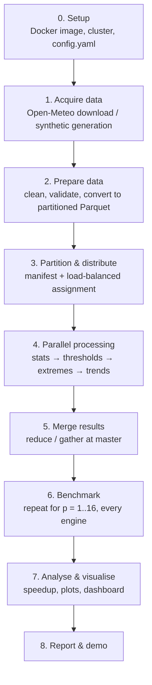
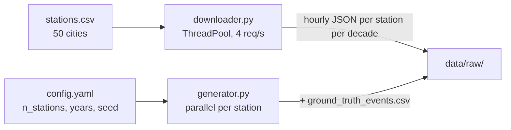
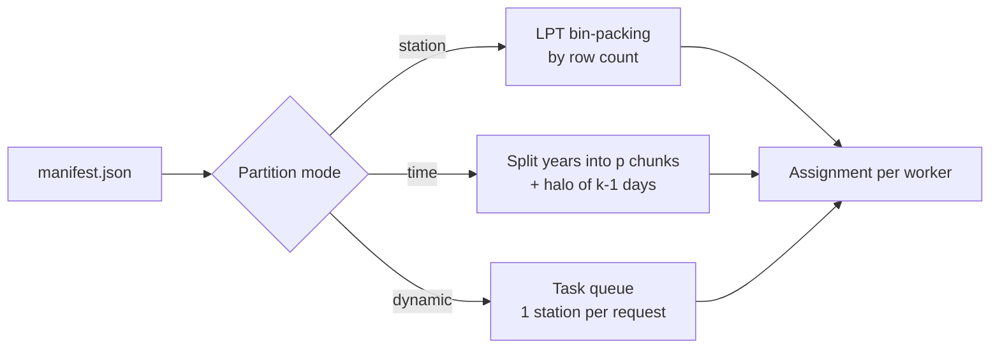
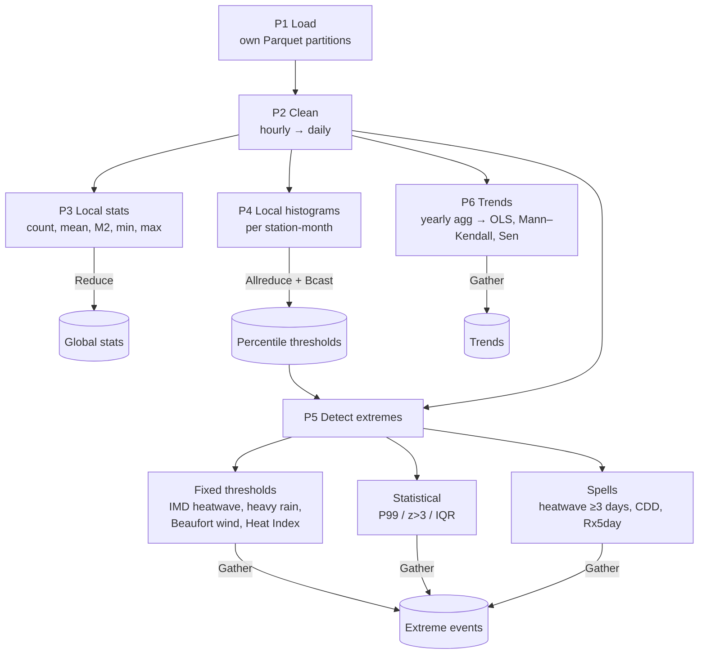
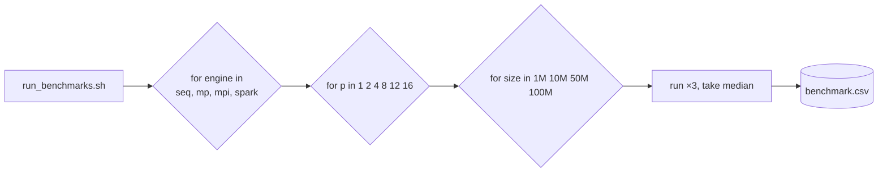
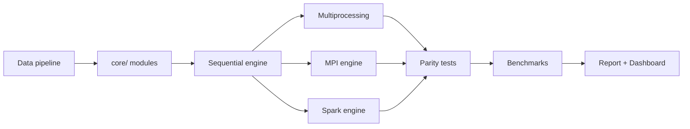
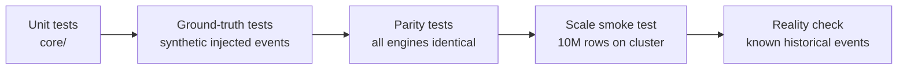

# Project Workflow
## Distributed Weather Data Processing and Extreme Weather Detection

This document describes **how the system runs end to end** (data flow, stages, commands) and **how the team works on it** (development flow, testing, benchmarking, demo, report). For design details and algorithms, see [implementation_plan.md](implementation_plan.md).

---

## 1. End-to-End Workflow at a Glance



---

## 2. Stage-by-Stage Workflow

### Stage 0: Environment & Cluster Setup

| Step | Action | Check |
|---|---|---|
| 0.1 | Clone repo, `pip install -r requirements.txt` (local dev) | `python -c "import mpi4py, pyspark"` |
| 0.2 | Build image `docker compose build` | Image `pds-weather` exists |
| 0.3 | Start cluster `docker compose up -d` (master + 3 workers) | `docker ps` shows 4 containers |
| 0.4 | Verify MPI across nodes | `mpirun --hostfile hostfile -np 4 hostname` prints 4 different hosts |
| 0.5 | Verify Spark | Spark UI at `http://localhost:8080` shows 3 workers |
| 0.6 | Edit `config.yaml` (stations, years, thresholds, paths) | Config loads without error |

```bash
docker compose -f docker/docker-compose.yml up -d
```

```bash
docker exec -it master mpirun --hostfile /app/docker/hostfile -np 4 hostname
```

**Lab LAN variant:** install the same image on 3–4 lab PCs, put their IPs in `hostfile`, and start Spark workers pointing to `spark://<master-ip>:7077`.

---

### Stage 1: Data Acquisition



| Input | Process | Output |
|---|---|---|
| `stations.csv` (id, name, lat, lon) | Fetch `temperature_2m, relative_humidity_2m, precipitation, wind_speed_10m, wind_gusts_10m` for 1995–2024 | `data/raw/openmeteo/<station>_<decade>.json` |
| Generator config (stations, years, size) | Simulate seasonal + diurnal + trend + noise; inject extremes | `data/raw/synthetic/*.csv` + `ground_truth_events.csv` |

```bash
python data/downloader.py --stations data/stations.csv --start 1995-01-01 --end 2024-12-31
```

```bash
python data/generator.py --stations 1000 --years 30 --rows-target 100M --workers 8
```

---

### Stage 2: Data Preparation

| Step | Operation |
|---|---|
| 2.1 | Parse raw files into the unified schema (see plan §3.3) |
| 2.2 | Unit normalisation (°C, %, mm, km/h), UTC timestamps |
| 2.3 | Validation: range checks, duplicate removal, gap flagging |
| 2.4 | Write **Parquet partitioned by `station_id`** |
| 2.5 | Write `manifest.json` with station → row count, file path, years covered |
| 2.6 | Write `data_quality_report.csv` with % missing and % flagged per station |

```bash
python data/to_parquet.py --input data/raw/openmeteo --output data/parquet/real
```

**Output layout:**
```
data/parquet/real/
├── station_id=DEL/part-0.parquet
├── station_id=MUM/part-0.parquet
├── ...
└── manifest.json
```

---

### Stage 3: Partitioning & Work Distribution



Example (station mode, 4 workers, LPT):

| Worker | Stations | Total rows |
|---|---|---|
| Rank 0 | DEL, CHN, … (13) | 3.28 M |
| Rank 1 | MUM, KOL, … (12) | 3.27 M |
| Rank 2 | BLR, HYD, … (13) | 3.29 M |
| Rank 3 | LDN, NYC, … (12) | 3.26 M |

Balanced rows mean balanced work, which keeps any single worker from slowing the whole job down.

---

### Stage 4: Parallel Processing (inside every worker)



**Run commands (same data, different engines):**

```bash
python -m engines.sequential --data data/parquet/real --out results/
```

```bash
python -m engines.parallel_mp --data data/parquet/real --workers 8 --out results/
```

```bash
mpirun --hostfile docker/hostfile -np 8 python -m engines.mpi_engine --data /data/parquet/real --mode station --out /results/
```

```bash
spark-submit --master spark://master:7077 --executor-cores 2 --num-executors 4 engines/spark_engine.py --data /data/parquet/real --out /results/
```

Every engine logs per-phase timings with a shared `PhaseTimer` (wall-clock; `MPI.Wtime()` for MPI, taking the **max across ranks** since the slowest rank determines the total).

---

### Stage 5: Result Merging & Output

| Result | Combined how | Written by |
|---|---|---|
| Global min/max/mean/std | Custom MPI reduce op / Spark `agg` | Master |
| Per-station stats | Gather (already disjoint) | Master |
| Extreme events | Gather → concat → sort by time | Master |
| Trends | Gather → concat | Master |
| Timings | Gather → max per phase | Master |

```
results/mpi_p8_2026-11-20T14-03/
├── summary_stats.csv
├── global_records.json
├── extreme_events.csv
├── extreme_summary.csv
├── trends.csv
├── timings.json
└── run_config.yaml        # exact config for reproducibility
```

**Sample console summary printed at the end of every run:**
```
=== Weather Analysis Complete (engine=mpi, p=8, mode=station) ===
Rows processed        : 13,149,600   (50 stations, 1995–2024)
Hottest Tmax          : 48.6 °C  @ Phalodi  2016-05-19
Max 24h rainfall      : 289.4 mm @ Chennai  2015-12-01
Max wind gust         : 152 km/h @ Bhubaneswar 1999-10-29
Extreme events found  : 4,812  (heatwave 1,204 | heavy rain 2,031 | wind 388 | humidity 1,189)
Stations warming (MK) : 41 / 50 significant, median +0.27 °C/decade
Total time            : 9.84 s   (load 2.1 | clean 3.0 | stats 0.6 | thresh 0.4 | detect 2.5 | trend 1.2)
```
*(values are illustrative)*

---

### Stage 6: Benchmarking



```bash
bash benchmark/run_benchmarks.sh --repeats 3
```

Rules for fair benchmarking:
- Same dataset, same output, same machine(s) for every engine
- Close other applications; record CPU model, cores, RAM, network in `run_config.yaml`
- Discard the warm-up run (OS file cache, JVM start) or report it separately
- Verify engine outputs match (parity test) before trusting the times

---

### Stage 7: Analysis & Visualisation

```bash
python benchmark/analyze.py --input results/benchmark.csv --plots results/plots/
```

```bash
python reporting/make_report.py --run results/mpi_p8_latest --out results/report.html
```

```bash
streamlit run reporting/dashboard.py
```

Streaming extension (live alerts from a replayed feed, Spark Structured Streaming; the dashboard's
"Live stream" tab follows it):

```bash
python -m streaming.demo --list
python -m streaming.demo --scenario heatwave_2024
```

| Plot | Shows |
|---|---|
| Speedup vs p (with ideal line) | Scalability per engine |
| Efficiency vs p | Where overhead starts to dominate |
| Phase breakdown stacked bar | Which phase is the bottleneck (I/O vs compute vs comm) |
| Time vs data size | Spark overtakes multiprocessing at scale |
| Annual Tmax trend lines (selected cities) | Warming trend |
| Extreme events per year (stacked by type) | Are extremes increasing? |
| Station × year heatmap of heatwave days | Spatial and temporal pattern |
| Rainfall distribution with IMD category bands | Heavy-rain frequency |
| Map of stations coloured by °C/decade | Geographic trend view |

---

## 3. Development Workflow (Team)

### 3.1 Git branching
```
main            ← stable, demo-ready
└── dev         ← integration
    ├── feature/data-pipeline
    ├── feature/core-analytics
    ├── feature/mpi-engine
    ├── feature/spark-engine
    └── feature/benchmark-report
```
- Small PRs into `dev`, with one teammate reviewing each
- `pytest` must pass before merge
- Merge `dev` into `main` at each weekly milestone and tag it (`v0.1-baseline`, `v0.2-mp`, `v0.3-mpi`, …)

### 3.2 Build order (dependencies)



**Always get the sequential version correct first.** It is both the correctness reference and T₁ for the speedup numbers.

### 3.3 Definition of done (per engine)
- [ ] Runs on the 1M sample in < 1 min
- [ ] Output files match the schema
- [ ] Parity test vs sequential passes
- [ ] Per-phase timings recorded
- [ ] Works on the multi-node cluster (MPI/Spark)
- [ ] README section with run command

### 3.4 Weekly cycle
| Day | Activity |
|---|---|
| Mon | Stand-up: plan the week's milestone (see plan §12) |
| Tue–Thu | Build on feature branches |
| Fri | Integrate into `dev`, run tests + a small benchmark |
| Lab session | Run on the lab cluster, collect real multi-node timings |

---

## 4. Testing Workflow



```bash
pytest tests/ -v
```

Detection quality report on synthetic data:

| Event type | Injected | Detected | Precision | Recall |
|---|---|---|---|---|
| Heatwave | n/a | n/a | n/a | n/a |
| Heavy rain | n/a | n/a | n/a | n/a |
| High wind | n/a | n/a | n/a | n/a |
| Humidity | n/a | n/a | n/a | n/a |

*(fill after Week 3)*

---

## 5. Demo Workflow (for lab evaluation, ~10 min)

| # | Step | What the examiner sees |
|---|---|---|
| 1 | Show architecture diagram | Plan §4 |
| 2 | `docker ps` / show lab PCs | 4-node cluster is live |
| 3 | Run the **sequential** engine on 13M rows | Baseline time, e.g. ~80 s |
| 4 | Run **MPI with 8 processes across 4 nodes** | Same results in ~10 s, with phase timings |
| 5 | Open the **Spark UI** during the Spark run | DAG, stages, tasks spread over workers |
| 6 | Kill one Spark worker mid-run | Job still completes (fault tolerance) |
| 7 | Show `extreme_events.csv` + global records | The required min/max/avg output and extreme records |
| 8 | Open the dashboard: trends + map | Trends output |
| 9 | Show speedup/efficiency plots | Processing time analysis and scalability |
| 10 | Conclude with Amdahl discussion | Why speedup is not perfectly linear |

**Backup:** pre-recorded screen capture + saved `results/` in case the network or cluster fails during the demo.

---

## 6. Final Report Outline

1. Abstract
2. Introduction & motivation (why extreme-weather detection needs distributed processing)
3. Dataset description (Open-Meteo/ERA5 + synthetic), data quality
4. System architecture & cluster setup
5. Methodology
   5.1 Statistics (mergeable aggregates, Welford/Chan)
   5.2 Extreme detection (thresholds, statistical, spells)
   5.3 Trend analysis (OLS, Mann–Kendall, Sen's slope)
6. Parallel & distributed design
   6.1 Multiprocessing  6.2 MPI (communication pattern, partitioning, load balancing, halo)  6.3 Spark (DAG, shuffles)
7. Results: weather findings (min/max/avg, extremes, trends)
8. Results: performance (speedup, efficiency, scaling, framework comparison)
9. Discussion: bottlenecks, Amdahl/Gustafson, trade-offs
10. Limitations & future work
11. Conclusion
12. References (IMD heatwave criteria, WMO/ETCCDI indices, Beaufort scale, NWS Heat Index, Open-Meteo, mpi4py, Spark docs)

---

## 7. Viva / Q&A Preparation

| Likely question | Key points to answer |
|---|---|
| Why is this problem parallelisable? | Stations are independent and most phases are maps; only the merge phases need communication |
| Why partition by station instead of time? | No boundary events and minimal communication; time mode needs halo exchange and is used to show that trade-off |
| How do you compute a global mean/std without centralising data? | Mergeable partials (count, mean, M2) combined with Chan's formula in a custom MPI reduce op |
| How do you compute percentiles in a distributed way? | Merged fixed-bin histograms (Allreduce), or Spark's approximate quantiles (Greenwald–Khanna) |
| Why isn't speedup linear? | Serial fraction (Amdahl), I/O contention, communication, load imbalance, Python/JVM overhead |
| MPI vs Spark: when would you choose each? | MPI: low latency and fine control for HPC-style work; Spark: fault tolerance and a higher-level API, better for very large data and commodity clusters |
| How did you verify correctness? | Parity tests across engines + ground-truth injected events + spot checks against known events |
| How is fault tolerance handled? | Spark recomputes from lineage; MPI has none built in, so we checkpoint per phase |
| What is the load-balancing strategy? | LPT greedy by row count; dynamic master–worker for heterogeneous nodes |

---

## 8. Quick Command Reference

| Task | Command |
|---|---|
| Start cluster | `docker compose -f docker/docker-compose.yml up -d` |
| Download real data | `python data/downloader.py` |
| Generate synthetic data | `python data/generator.py --rows-target 100M` |
| Convert to Parquet | `python data/to_parquet.py` |
| Sequential run | `python -m engines.sequential` |
| Multiprocessing run | `python -m engines.parallel_mp --workers 8` |
| MPI run | `mpirun --hostfile docker/hostfile -np 8 python -m engines.mpi_engine` |
| Spark run | `spark-submit --master spark://master:7077 engines/spark_engine.py` |
| All benchmarks | `bash benchmark/run_benchmarks.sh` |
| Plots | `python benchmark/analyze.py` |
| Report | `python reporting/make_report.py` |
| Dashboard | `streamlit run reporting/dashboard.py` |
| Streaming demo (extension) | `python -m streaming.demo --scenario heatwave_2024` (dashboard tab "Live stream") |
| Streaming run summary | `python -m streaming.summarize` |
| Tests | `pytest tests/ -v` |
| Stop cluster | `docker compose -f docker/docker-compose.yml down` |
