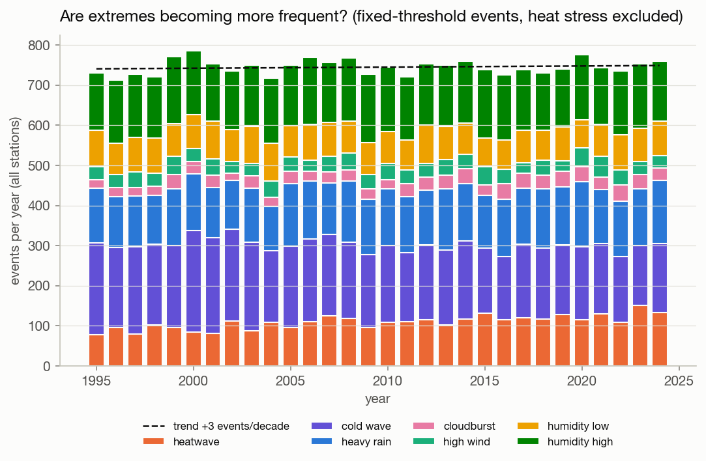
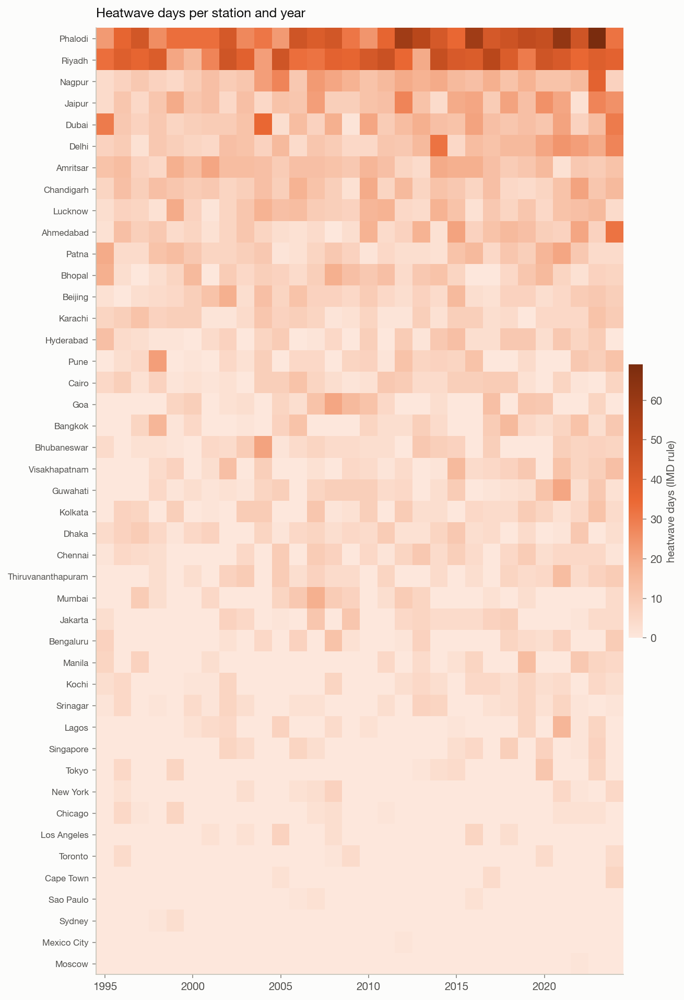
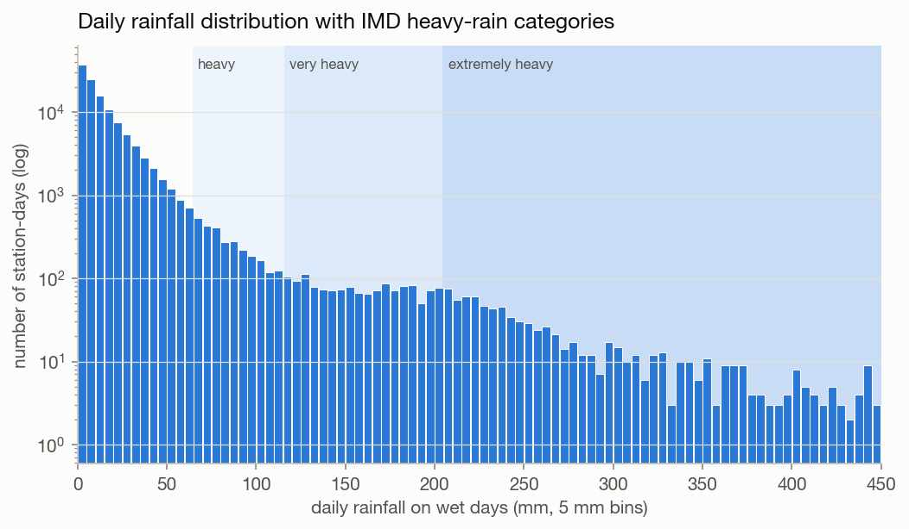
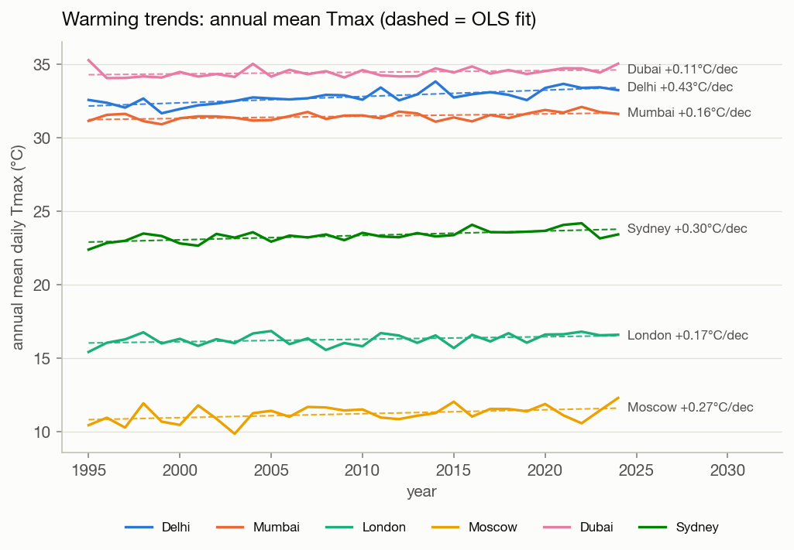
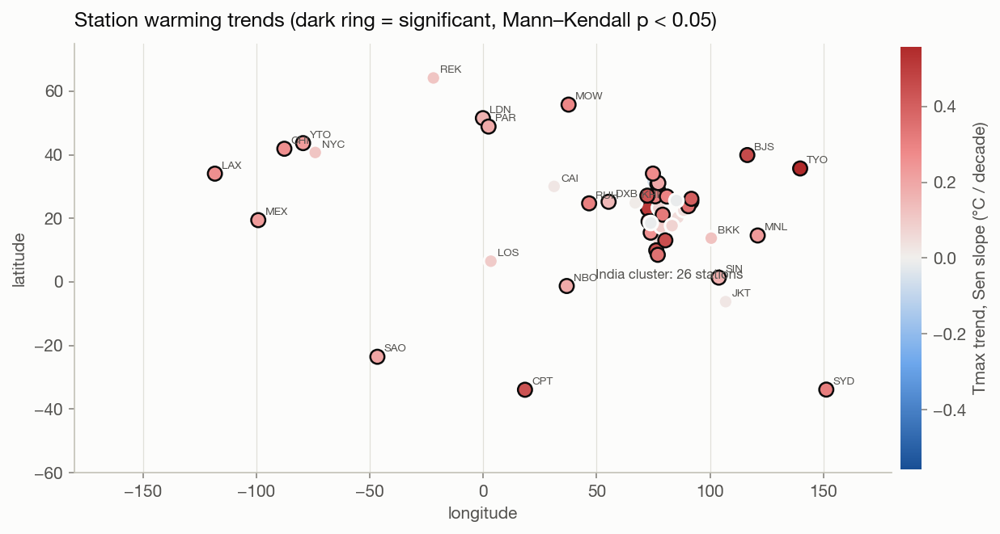
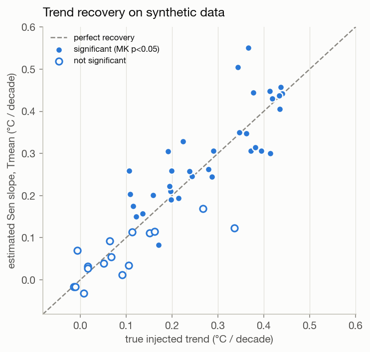

# Weather Data Processing & Extreme Weather Detection: Results Report

Run `sequential_p1_2026-10-18T20-41-58` · engine **sequential** · p = 1 · 13,150,250 hourly rows · 50 stations · 1995–2024 · source: synthetic

## 1. Global records

| record | value | station | when |
|---|---|---|---|
| highest temperature | 52.6 °C | PHL | 2021-06-15 10:00 |
| lowest temperature | -29.2 °C | MOW | 2011-02-18 23:00 |
| max daily rainfall | 891.8 mm/day | CHE | 2015-07-21 00:00 |
| max hourly rainfall | 494.0 mm/h | CHE | 2005-06-14 20:00 |
| max wind speed | 149.8 km/h | LOS | 2009-04-30 23:00 |
| max wind gust | 218.3 km/h | MAA | 2022-10-20 02:00 |
| max humidity | 100.0 % | SAO | 1995-01-01 04:00 |
| min humidity | 5.0 % | RUH | 1995-01-05 10:00 |

### Global min / max / average (all stations, all hours)

| variable | count | mean | std | min | max |
|---|---|---|---|---|---|
| gust_kmh | 13136476 | 18.04 | 12.16 | 0.00 | 218.30 |
| humidity_pct | 13136356 | 65.89 | 17.77 | 5.00 | 100.00 |
| precip_mm | 13135830 | 0.17 | 1.91 | 0.00 | 494.00 |
| precip_sum | 547900 | 4.15 | 17.63 | 0.00 | 891.80 |
| temp_c | 13135841 | 22.26 | 9.53 | -29.20 | 52.60 |
| wind_kmh | 13135864 | 11.64 | 7.79 | 0.00 | 149.80 |

### Data quality (handled in P2 clean)

13,150,250 rows read · 650 duplicate timestamps removed · 65,341 missing values · 2,292 out-of-range values set to NaN · 309 humidity values clipped to 100 %.

## 2. Extreme weather events

| method | event_type | events | event_days | stations |
|---|---|---|---|---|
| iqr | rain_iqr | 2233 | 2451 | 50 |
| iqr | wind_iqr | 257 | 454 | 42 |
| percentile | cold_night_p01 | 3753 | 5935 | 50 |
| percentile | hot_day_p99 | 3426 | 5091 | 50 |
| percentile | rain_p99 | 1090 | 1145 | 50 |
| percentile | wind_p99 | 4912 | 5269 | 50 |
| spell | heatwave_spell | 1176 | 5621 | 40 |
| spell | warm_spell | 1287 | 9192 | 50 |
| threshold | cloudburst | 904 | 947 | 50 |
| threshold | cold_wave | 5792 | 12838 | 46 |
| threshold | heat_stress | 20391 | 139215 | 49 |
| threshold | heatwave | 3266 | 8237 | 44 |
| threshold | heavy_rain | 4155 | 5162 | 50 |
| threshold | high_wind | 1089 | 1362 | 27 |
| threshold | humidity_high | 4659 | 12071 | 34 |
| threshold | humidity_low | 2482 | 8354 | 18 |
| zscore | cold_zscore | 872 | 2148 | 50 |
| zscore | hot_zscore | 1113 | 2577 | 50 |
| zscore | wind_zscore | 2669 | 2944 | 50 |

### Most intense event per category

| event_type | station_id | severity | start_date | duration_days | peak_value |
|---|---|---|---|---|---|
| heavy_rain | CHE | extremely_heavy | 2015-07-20 | 4 | 891.8 |
| cloudburst | CHE | cloudburst | 2005-06-14 | 1 | 494.0 |
| heat_stress | JKT | extreme_danger | 2009-10-03 | 5 | 191.4 |
| high_wind | LOS | B12_hurricane | 2009-04-30 | 2 | 149.8 |
| humidity_high | CHE | saturated | 2019-06-07 | 68 | 100.0 |
| heatwave | PHL | severe_heatwave | 2021-06-12 | 17 | 52.6 |
| humidity_low | PHL | very_dry | 2005-06-01 | 1 | 10.0 |
| cold_wave | JAI | cold_wave | 2000-09-19 | 1 | 10.0 |

### Detection quality vs injected ground truth

Recall = injected events found by ≥1 detector of the matching family. Precision = share of a detector's events that coincide with an injected event; the synthetic climate also produces natural extremes, so this is a lower bound.

| injected_type | injected | detected_any_method | recall_any |
|---|---|---|---|
| heatwave | 1112 | 1004 | 0.903 |
| cold_wave | 660 | 633 | 0.959 |
| cloudburst | 640 | 640 | 1.000 |
| cyclone | 216 | 216 | 1.000 |

| detector | matches_injected | detected | overlap_injected | precision | recall |
|---|---|---|---|---|---|
| heatwave | heatwave | 3266 | 851 | 0.261 | 0.713 |
| heatwave_spell | heatwave | 1176 | 635 | 0.540 | 0.595 |
| hot_day_p99 | heatwave | 3426 | 641 | 0.187 | 0.504 |
| hot_zscore | heatwave | 1113 | 745 | 0.669 | 0.603 |
| warm_spell | heatwave | 1287 | 414 | 0.322 | 0.402 |
| cold_wave | cold_wave | 5792 | 518 | 0.089 | 0.765 |
| cold_night_p01 | cold_wave | 3753 | 528 | 0.141 | 0.692 |
| cold_zscore | cold_wave | 872 | 553 | 0.634 | 0.767 |
| cloudburst | cloudburst | 904 | 632 | 0.699 | 0.997 |
| heavy_rain | cloudburst | 4155 | 634 | 0.153 | 1.000 |
| rain_p99 | cloudburst | 1090 | 405 | 0.372 | 0.637 |
| rain_iqr | cloudburst | 2233 | 610 | 0.273 | 0.963 |
| high_wind | cyclone | 1089 | 213 | 0.196 | 1.000 |
| wind_p99 | cyclone | 4912 | 209 | 0.043 | 0.981 |
| wind_zscore | cyclone | 2669 | 213 | 0.080 | 1.000 |
| wind_iqr | cyclone | 257 | 207 | 0.805 | 0.972 |

## 3. Trends

* **34 / 50** stations show a significant warming of annual mean Tmax (Mann–Kendall p < 0.05); median Sen slope **+0.22 °C/decade**.
* Heatwave days: 8 stations with a significant increase, 0 with a significant decrease.

Recovery of the generator's true trend: mean absolute error **0.051 °C/decade**, correlation 0.88.

## 4. Processing time & scalability

This run: **11.12 s** wall (excluding 0.25 s writing outputs). Phases (slowest worker): load 0.21 s, clean 1.80 s, stats 6.38 s, thresholds 0.18 s, detect 1.86 s, trends 0.64 s.

### File format: CSV vs Parquet

| format | columns | rows | seconds | mib | mrows_per_s |
|---|---|---|---|---|---|
| csv | all | 1315025 | 1.664 | 94.311 | 0.790 |
| csv | 6 needed | 1315025 | 1.552 | 94.311 | 0.847 |
| parquet | all | 1315025 | 0.044 | 17.446 | 30.225 |
| parquet | 6 needed (pruned) | 1315025 | 0.015 | 17.446 | 87.905 |
