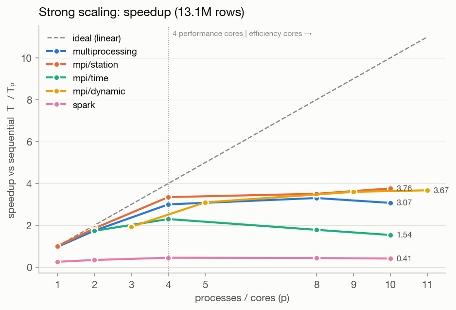
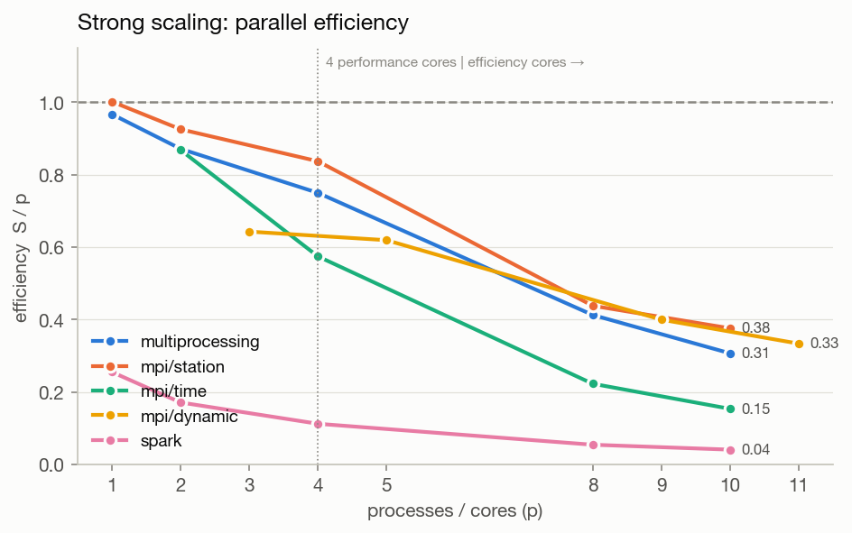
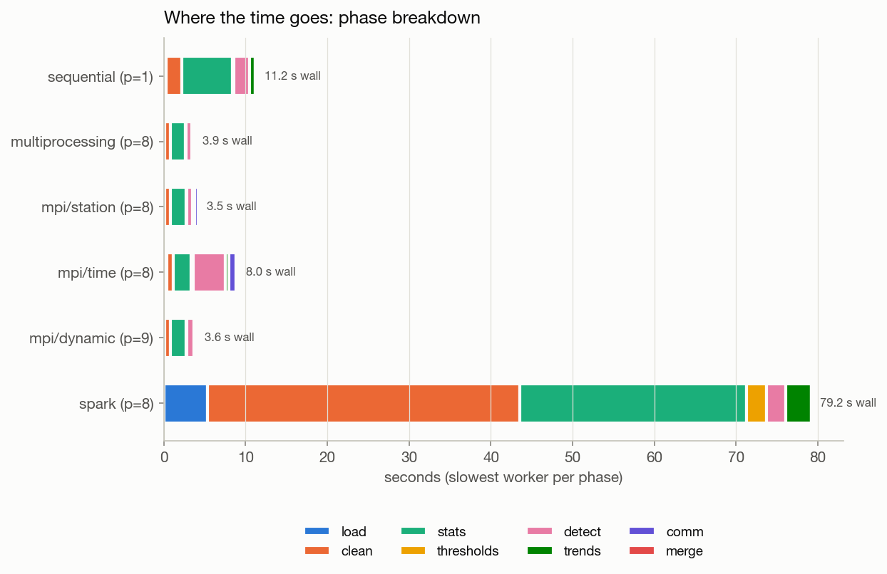
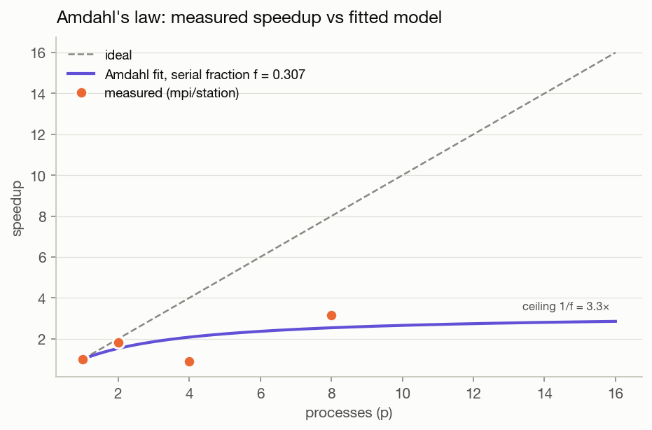
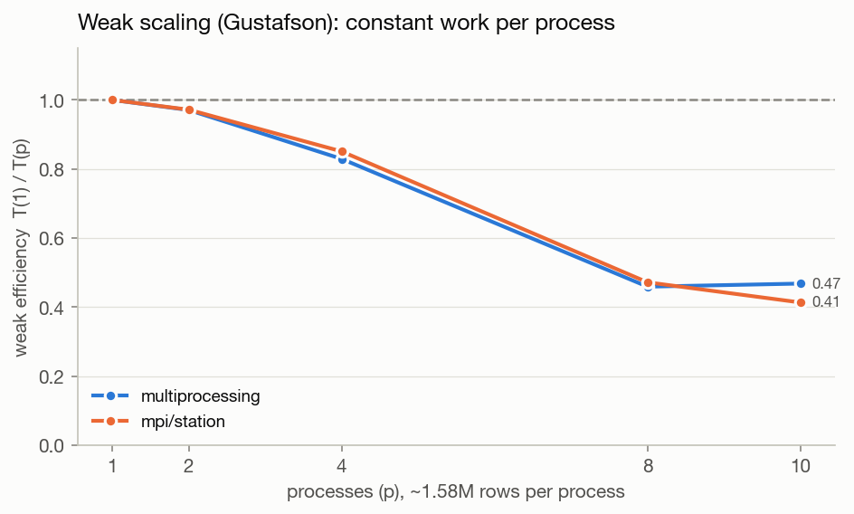
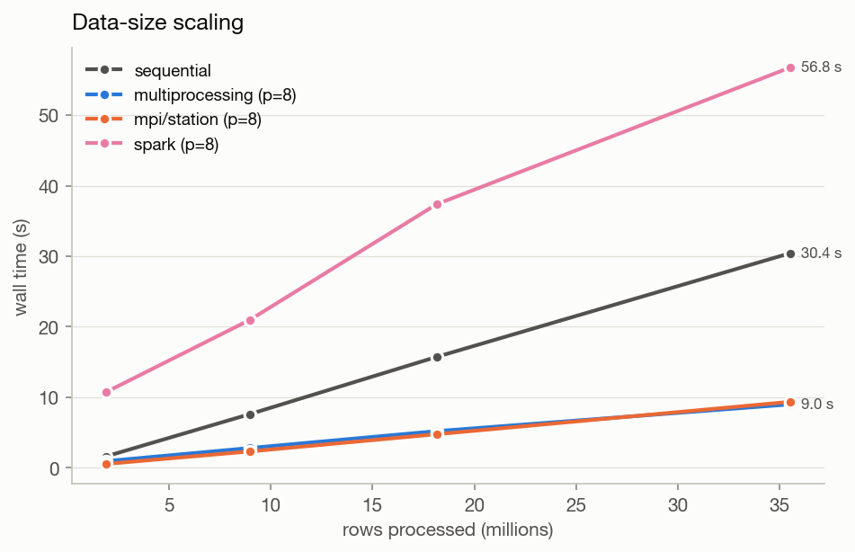
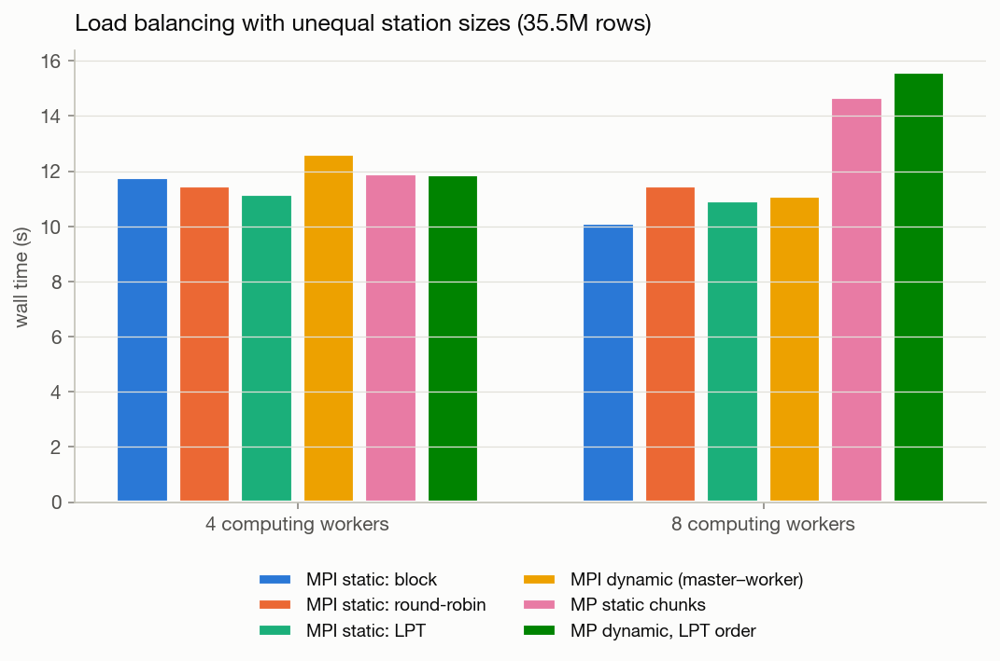
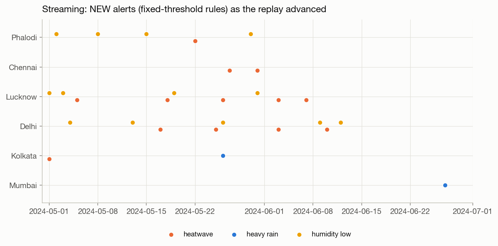
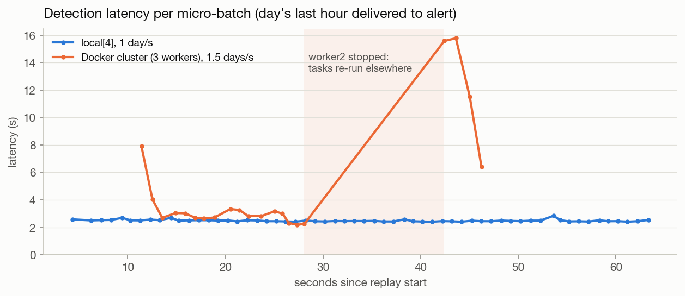

# Weather Data Processing & Extreme Weather Detection: Results Report

Run `mpi_p8_station_2026-10-18T23-28-29` · engine **mpi** · p = 8 · 13,150,250 hourly rows · 50 stations · 1995–2024 · source: synthetic

## 1. Global records

| record | value | station | when |
|---|---|---|---|
| highest temperature | 52.6 °C | PHL | 2021-06-15 10:00 |
| lowest temperature | -29.2 °C | MOW | 2011-02-18 23:00 |
| max daily rainfall | 891.8 mm/day | CHE | 2015-07-21 00:00 |
| max hourly rainfall | 494.0 mm/h | CHE | 2005-06-14 20:00 |
| max wind speed | 149.8 km/h | LOS | 2009-04-30 23:00 |
| max wind gust | 218.3 km/h | MAA | 2022-10-20 02:00 |
| max humidity | 100.0 % | SAO | 1995-01-01 04:00 |
| min humidity | 5.0 % | RUH | 1995-01-05 10:00 |

### Global min / max / average (all stations, all hours)

| variable | count | mean | std | min | max |
|---|---|---|---|---|---|
| gust_kmh | 13136476 | 18.04 | 12.16 | 0.00 | 218.30 |
| humidity_pct | 13136356 | 65.89 | 17.77 | 5.00 | 100.00 |
| precip_mm | 13135830 | 0.17 | 1.91 | 0.00 | 494.00 |
| precip_sum | 547900 | 4.15 | 17.63 | 0.00 | 891.80 |
| temp_c | 13135841 | 22.26 | 9.53 | -29.20 | 52.60 |
| wind_kmh | 13135864 | 11.64 | 7.79 | 0.00 | 149.80 |

### Data quality (handled in P2 clean)

13,150,250 rows read · 650 duplicate timestamps removed · 65,341 missing values · 2,292 out-of-range values set to NaN · 309 humidity values clipped to 100 %.

## 2. Extreme weather events

| method | event_type | events | event_days | stations |
|---|---|---|---|---|
| iqr | rain_iqr | 2233 | 2451 | 50 |
| iqr | wind_iqr | 257 | 454 | 42 |
| percentile | cold_night_p01 | 3753 | 5935 | 50 |
| percentile | hot_day_p99 | 3426 | 5091 | 50 |
| percentile | rain_p99 | 1090 | 1145 | 50 |
| percentile | wind_p99 | 4912 | 5269 | 50 |
| spell | heatwave_spell | 893 | 4162 | 25 |
| spell | warm_spell | 1287 | 9192 | 50 |
| threshold | cloudburst | 904 | 947 | 50 |
| threshold | cold_wave | 1462 | 3332 | 22 |
| threshold | heat_stress | 20391 | 139215 | 49 |
| threshold | heatwave | 2553 | 6225 | 25 |
| threshold | heavy_rain | 4155 | 5162 | 50 |
| threshold | high_wind | 1089 | 1362 | 27 |
| threshold | humidity_high | 4659 | 12071 | 34 |
| threshold | humidity_low | 2482 | 8354 | 18 |
| zscore | cold_zscore | 872 | 2148 | 50 |
| zscore | hot_zscore | 1113 | 2577 | 50 |
| zscore | wind_zscore | 2669 | 2944 | 50 |

### Most intense event per category

| event_type | station_id | severity | start_date | duration_days | peak_value |
|---|---|---|---|---|---|
| heavy_rain | CHE | extremely_heavy | 2015-07-20 | 4 | 891.8 |
| cloudburst | CHE | cloudburst | 2005-06-14 | 1 | 494.0 |
| heat_stress | JKT | extreme_danger | 2009-10-03 | 5 | 191.4 |
| high_wind | LOS | B12_hurricane | 2009-04-30 | 2 | 149.8 |
| humidity_high | LOS | saturated | 2003-07-16 | 5 | 100.0 |
| heatwave | PHL | severe_heatwave | 2021-06-12 | 17 | 52.6 |
| humidity_low | RUH | very_dry | 2003-07-05 | 1 | 10.0 |
| cold_wave | PNQ | cold_wave | 2010-09-07 | 1 | 10.0 |

### Detection quality vs injected ground truth

Recall = injected events found by ≥1 detector of the matching family. Precision = share of a detector's events that coincide with an injected event; the synthetic climate also produces natural extremes, so this is a lower bound.

| injected_type | injected | detected_any_method | recall_any |
|---|---|---|---|
| heatwave | 1112 | 959 | 0.862 |
| cold_wave | 660 | 581 | 0.880 |
| cloudburst | 640 | 640 | 1.000 |
| cyclone | 216 | 216 | 1.000 |

| detector | matches_injected | detected | overlap_injected | precision | recall |
|---|---|---|---|---|---|
| heatwave | heatwave | 2553 | 573 | 0.224 | 0.483 |
| heatwave_spell | heatwave | 893 | 463 | 0.518 | 0.432 |
| hot_day_p99 | heatwave | 3426 | 641 | 0.187 | 0.504 |
| hot_zscore | heatwave | 1113 | 745 | 0.669 | 0.603 |
| warm_spell | heatwave | 1287 | 414 | 0.322 | 0.402 |
| cold_wave | cold_wave | 1462 | 252 | 0.172 | 0.364 |
| cold_night_p01 | cold_wave | 3753 | 528 | 0.141 | 0.692 |
| cold_zscore | cold_wave | 872 | 553 | 0.634 | 0.767 |
| cloudburst | cloudburst | 904 | 632 | 0.699 | 0.997 |
| heavy_rain | cloudburst | 4155 | 634 | 0.153 | 1.000 |
| rain_p99 | cloudburst | 1090 | 405 | 0.372 | 0.637 |
| rain_iqr | cloudburst | 2233 | 610 | 0.273 | 0.963 |
| high_wind | cyclone | 1089 | 213 | 0.196 | 1.000 |
| wind_p99 | cyclone | 4912 | 209 | 0.043 | 0.981 |
| wind_zscore | cyclone | 2669 | 213 | 0.080 | 1.000 |
| wind_iqr | cyclone | 257 | 207 | 0.805 | 0.972 |

## 3. Trends

* **34 / 50** stations show a significant warming of annual mean Tmax (Mann–Kendall p < 0.05); median Sen slope **+0.22 °C/decade**.
* Heatwave days: 8 stations with a significant increase, 0 with a significant decrease.

Recovery of the generator's true trend: mean absolute error **0.051 °C/decade**, correlation 0.88.

## 4. Processing time & scalability

This run: **4.31 s** wall (excluding 0.34 s writing outputs). Phases (slowest worker): load 0.23 s, clean 0.96 s, stats 2.12 s, thresholds 0.07 s, detect 0.96 s, trends 0.35 s, comm 0.47 s.

Median of repeated runs on the same 13.1M-row dataset (T₁ = sequential):

| label | p | runs | total_s | speedup | efficiency | karp_flatt |
|---|---|---|---|---|---|---|
| mpi/dynamic | 3 | 3 | 5.695 | 1.929 | 0.643 | 0.278 |
| mpi/dynamic | 5 | 3 | 3.548 | 3.096 | 0.619 | 0.154 |
| mpi/dynamic | 9 | 3 | 3.052 | 3.599 | 0.400 | 0.188 |
| mpi/dynamic | 11 | 3 | 2.992 | 3.671 | 0.334 | 0.200 |
| mpi/station | 1 | 3 | 10.966 | 1.002 | 1.002 |  |
| mpi/station | 2 | 3 | 5.935 | 1.851 | 0.925 | 0.081 |
| mpi/station | 4 | 3 | 3.281 | 3.348 | 0.837 | 0.065 |
| mpi/station | 8 | 3 | 3.133 | 3.506 | 0.438 | 0.183 |
| mpi/station | 10 | 3 | 2.921 | 3.761 | 0.376 | 0.184 |
| mpi/time | 2 | 3 | 6.326 | 1.736 | 0.868 | 0.152 |
| mpi/time | 4 | 3 | 4.780 | 2.298 | 0.575 | 0.247 |
| mpi/time | 8 | 3 | 6.156 | 1.784 | 0.223 | 0.498 |
| mpi/time | 10 | 3 | 7.140 | 1.538 | 0.154 | 0.611 |
| multiprocessing | 1 | 3 | 11.359 | 0.967 | 0.967 |  |
| multiprocessing | 2 | 3 | 6.303 | 1.743 | 0.871 | 0.148 |
| multiprocessing | 4 | 3 | 3.662 | 2.999 | 0.750 | 0.111 |
| multiprocessing | 8 | 3 | 3.325 | 3.304 | 0.413 | 0.203 |
| multiprocessing | 10 | 3 | 3.577 | 3.071 | 0.307 | 0.251 |
| sequential | 1 | 3 | 10.984 | 1.000 | 1.000 |  |
| spark | 1 | 3 | 43.007 | 0.255 | 0.255 |  |
| spark | 2 | 3 | 32.057 | 0.343 | 0.171 | 4.837 |
| spark | 4 | 3 | 24.405 | 0.450 | 0.113 | 2.629 |
| spark | 8 | 3 | 25.109 | 0.438 | 0.055 | 2.470 |
| spark | 10 | 3 | 26.720 | 0.411 | 0.041 | 2.592 |

### Multi-node run: Docker Compose cluster (master + 3 workers)

Same image on every node; MPI ranks launched over SSH from a hostfile, Spark in standalone mode (`spark://master:7077`). All four containers share one 8-CPU Docker Desktop VM and read the data through a virtualised shared volume, so absolute times are slower than native; the point is that the same code runs distributed and produces identical results (parity checked). The `fault-tolerance` row had worker2 stopped mid-job: Spark recomputed the lost partitions from lineage and finished correctly.

| engine/mode | p | nodes | rows | total_s | tag |
|---|---|---|---|---|---|
| mpi/station | 8 | 4 | 13150250 | 7.16 | cluster |
| mpi/time | 8 | 4 | 13150250 | 15.58 | cluster |
| spark | 6 | 3 | 13150250 | 66.85 | cluster |
| spark | 4 | 2 | 13150250 | 70.65 | fault-tolerance |
| mpi/station | 8 | 4 | 13150250 | 4.31 | lan-sim |

### File format: CSV vs Parquet

| format | columns | rows | seconds | mib | mrows_per_s |
|---|---|---|---|---|---|
| csv | all | 2630050 | 3.252 | 186.941 | 0.809 |
| csv | 6 needed | 2630050 | 2.968 | 186.941 | 0.886 |
| parquet | all | 2630050 | 0.059 | 34.829 | 44.721 |
| parquet | 6 needed (pruned) | 2630050 | 0.027 | 34.829 | 95.737 |

## 5. Streaming extension: live detection

The batch engines analyse stored history. The streaming extension (`streaming/`) detects extremes while data arrives: a replayer feeds the stored hourly readings back as a live feed (6 simulated hours per Parquet file, written atomically), and **Spark Structured Streaming** deduplicates them with a 2-hour watermark, applies the batch engine's cleaning expressions and aggregates each station's day in a 1-day event-time window (append mode, so a day is emitted once, when complete). In `foreachBatch` the day is joined with the station-month thresholds from a batch run and evaluated with the same rule definitions; `core.streaming.StreamDetector` keeps one open run per station × rule and turns it into NEW / ESCALATED / ENDED alerts. It is gaps-and-islands, computed incrementally.

Every closed streamed event is compared with the batch run's events at the end of a run. Events already running when the replay starts, or still running at its end, are left out because the stream cannot see their full extent.

| run | master | stations | sim days/s | rows_in | alerts | rows_per_s | latency median / p95 (s) | parity |
|---|---|---|---|---|---|---|---|---|
| cluster/stream_amphan_2020_3workers | spark://master:7077 | 6 | 2.0 | 3168 | 50 | 207.2 | 7.47 / 9.12 | 22/22 |
| cluster/stream_heatwave_2024_worker_killed | spark://master:7077 | 6 | 1.5 | 8784 | 232 | 190.0 | 3.03 / 15.57 | 101/101 |
| stream/amphan_2020_2026-10-19T02-01-38 | local[4] | 6 | 2.0 | 3168 | 50 | 249.9 | 2.02 / 2.19 | 22/22 |
| stream/heatwave_2024_2026-10-19T01-53-46 | local[4] | 6 | 1.0 | 8784 | 232 | 139.4 | 2.28 / 2.48 | 101/101 |
| stream/heatwave_2024_2026-10-19T02-13-08 | local[4] | 6 | 1.0 | 8784 | 232 | 138.8 | 2.47 / 2.59 | 101/101 |
| stream/heatwave_2024_resume_after_driver_kill | local[4] | 6 | 2.0 | 8784 | 232 | 267.0 | 2.22 / 10.17 | 101/101 |
| stream/michaung_2023_2026-10-19T02-01-21 | local[4] | 6 | 2.0 | 2304 | 30 | 223.6 | 2.21 / 3.68 | 15/15 |
| stream/synthetic_2024_2026-10-19T01-55-02 | local[4] | 50 | 0.0 | 146407 | 1893 | 14017.9 | 6.37 / 9.72 | 865/865 |

* **Latency** is the wall-clock time from the replayer delivering a day's last hour to that day's alerts. It is about 2 s locally, made up of the watermark (the next file has to arrive), the 1 s trigger and about 0.3 s of processing. On the Docker cluster it is about 3 s.
* **Throughput.** Replayed as fast as possible, 50 synthetic stations stream at about 14,000 hourly rows/s on `local[4]`. Paced runs are limited by the replay speed, not by Spark.
* **Fault tolerance.** Spark checkpoints its file offsets and dedup/window state, and the detector saves its open runs after every micro-batch, skipping batch ids it has already processed. Stopping a worker mid-stream (Spark re-runs its tasks) and SIGKILLing the detector then restarting it with `--resume` both gave the same 232 alerts and identical events.
* Real events caught live: the 2024 heatwave (Delhi severe heatwave from 25 May, Phalodi 47.3 °C), Cyclone Amphan (Kolkata heavy rain and gale on 20 May 2020) and Cyclone Michaung (Chennai 254.9 mm, extremely heavy, on 4 Dec 2023).

